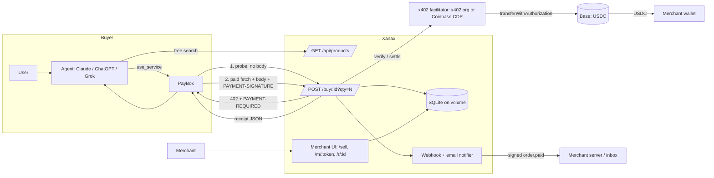

# Xanax: agent checkout for PayBox

> Turn any product into something an AI agent can buy: no Stripe account, no integration, paid in USDC straight to your wallet.

Xanax is a **merchant tool** for the PayBox marketplace (MoonPay Hackathons, Chapter 1). A small business fills in one form and gets a product URL protected by **x402** (HTTP 402, USDC on Base). A buyer's agent (Claude, ChatGPT or Grok with PayBox connected) calls that URL with PayBox's `use_service`. PayBox pays, Xanax verifies and settles through an x402 facilitator, the **USDC goes directly to the merchant's wallet**, the merchant gets a signed webhook (and an optional email), and the agent gets back a JSON receipt.

**Live URL:** _set after deploy_ (`BASE_URL`)

## The 30-second agent flow

1. The user says: *"Use PayBox to buy 1 × Single-origin coffee from Ada's Roastery, ship it to my address."*
2. The agent finds it, free: `GET /api/products?q=coffee` returns the id, price, required buyer fields and body schema.
3. The agent calls PayBox `use_service` with `{ url: "<base>/buy/p_…?qty=1", method: "POST", body: {"buyer": {...}} }`.
4. PayBox probes, gets a 402, gets passkey approval if the user's policy needs it, signs USDC, and re-fetches with the payment.
5. Xanax validates the body, verifies, settles (USDC goes to the merchant), records the order, and fires the webhook.
6. The agent gets `{ status: "paid", order_id, tx_hash, explorer_url, next_steps, receipt_url }`. Digital goods also get a download link.

## Architecture



### How the x402 flow works here

```
probe (no body) ──► 402  PAYMENT-REQUIRED: {scheme: exact, network: eip155:8453, amount: price×qty, payTo: merchant, asset: USDC}
                         price/payTo come from the URL (path + ?qty) only, so the probe and the paid fetch match
PayBox signs EIP-3009 transferWithAuthorization (user approves with passkey if needed)
paid fetch (body + PAYMENT-SIGNATURE)
  ├─ replayed payment? ───────────────► 200 original receipt (no second order)
  ├─ body missing required fields? ───► 400 {charged:false}  (facilitator never called)
  ├─ verify (facilitator) fails? ─────► 402
  ├─ reserve stock (atomic) fails? ───► 409 {charged:false}
  ├─ settle (facilitator → Base) ─────► USDC moves payer → merchant
  ├─ insert order UNIQUE(tx_hash, nonce)
  ├─ notify merchant (webhook first try ≤4s, retries in background; email optional)
  └─ 200 receipt + PAYMENT-RESPONSE header
```

## Routes

| Route | Who | What |
|---|---|---|
| `GET /` | human | Landing page, how it works, live products |
| `GET/POST /sell` | merchant | Create merchant + product. Shows the agent URL, buyer prompt, dashboard link and webhook secret (once) |
| `GET /m/:token` | merchant | Dashboard: products, orders, buyer details, tx links, resend webhook, mark fulfilled |
| `GET /api/products?q=` | agent | Free search: price, required buyer fields, JSON schema of the body |
| `GET /api/products/:id` | agent | Free product detail |
| `POST /buy/:id?qty=N` | agent | **x402-paid** purchase (`GET` also returns the 402 for default probes) |
| `GET /r/:orderId` / `.pdf` | anyone | Public receipt page and downloadable PDF (buyer copy, no buyer PII) |
| `GET /login`, `/logout`, `/account` | user | Privy sign-in; account with stores, sales, purchases, activity |
| `GET /account/stores/:id` | owner | Store dashboard for signed-in owners (same as the private link) |
| `GET …/orders/:id/receipt.pdf` | merchant | Seller copy of the receipt PDF, incl. buyer details |
| `GET /u/:id` | anyone | Uploaded product images |
| `GET /d/:orderId?t=` (+ `/file`) | buyer | Signed, expiring digital delivery (text, link or uploaded file) |
| `GET /llms.txt` | agent | How to use Xanax |
| `GET /.well-known/x402` | crawler | Discovery doc listing paid resources |
| `POST /admin/seed` | admin | Seeds the demo merchant (`Authorization: Bearer $ADMIN_TOKEN`) |

## Webhook format

```
POST <merchant webhook_url>
X-Xanax-Event: order.paid
X-Xanax-Timestamp: 1760700000
X-Xanax-Signature: sha256=<hex HMAC-SHA256(webhook_secret, "<timestamp>.<raw body>")>

{"event":"order.paid","order":{"id":"xnx_…","product":{…},"quantity":1,"amount_usd":"0.50","tx_hash":"0x…","buyer":{…},…}}
```

Verify it in Node:

```js
const expected = "sha256=" + crypto.createHmac("sha256", secret).update(`${ts}.${rawBody}`).digest("hex");
```

## Run locally

```bash
pnpm install
cp .env.example .env          # set BASE_URL, X402_NETWORK=base-sepolia, ADMIN_TOKEN, SEED_PAYOUT_ADDRESS
pnpm seed                     # demo merchant: Ada's Roastery (coffee + instant-delivery guide)
pnpm dev                      # http://localhost:3000
pnpm test                     # unit + end-to-end x402 tests (official client, fake facilitator)
pnpm typecheck

# Real testnet purchase (Base Sepolia USDC from https://faucet.circle.com):
BUYER_PRIVATE_KEY=0x… TARGET_URL=http://localhost:3000 pnpm test-buy
```

Node 22.13+ is required (built-in `node:sqlite`).

## Deploy (Railway)

1. New project → Deploy from GitHub → this repo. It builds the `Dockerfile` and health-checks `/health`.
2. Add a **volume** mounted at `/data` (the SQLite file is `/data/xanax.db`).
3. Set the env vars below, with `BASE_URL` = the Railway public URL.
4. Seed: `curl -X POST -H "Authorization: Bearer $ADMIN_TOKEN" $BASE_URL/admin/seed`

Switch to mainnet by setting `X402_NETWORK=base` plus `CDP_API_KEY_ID` and `CDP_API_KEY_SECRET`. Nothing else changes.

## Environment variables

| Var | Purpose |
|---|---|
| `APP_NAME` | Product name (default `Xanax`) |
| `BASE_URL` | Public https origin; used in product URLs and the x402 `resource.url` |
| `X402_NETWORK` | `base-sepolia` (x402.org facilitator) or `base` (Coinbase CDP facilitator) |
| `FACILITATOR_URL` | Optional facilitator override |
| `CDP_API_KEY_ID`, `CDP_API_KEY_SECRET` | CDP API key, required for mainnet |
| `DATABASE_URL` | `file:/data/xanax.db` |
| `RESEND_API_KEY`, `EMAIL_FROM` | Optional order emails |
| `PRIVY_APP_ID`, `PRIVY_APP_SECRET` | Privy app for sign-in (accounts). App ID is public; secret is used server-side to read the user's email/wallet |
| `ADMIN_TOKEN` | Bearer token for `/admin/seed` |
| `SIGNING_SECRET` | HMAC key for download links (falls back to `ADMIN_TOKEN`) |
| `MAX_PRICE_USD`, `MAX_QTY` | Limits (500, 10) |
| `SEED_PAYOUT_ADDRESS`, `SEED_EMAIL`, `SEED_WEBHOOK_URL` | Demo seed |
| `BUYER_PRIVATE_KEY`, `TARGET_URL` | `scripts/test-buy.ts` only |

## Security notes

- **Non-custodial:** `payTo` is always the merchant's wallet, and Xanax holds no keys or funds.
- **No charge on bad input:** the body is validated before the facilitator is called; sold-out returns 409 before a 402 is built; stock is reserved atomically and released if settle fails.
- **Idempotent:** `UNIQUE(tx_hash)` and `UNIQUE(payment_nonce)`. Replays return the original receipt.
- **Secrets:** dashboard tokens are 256-bit random and stored as SHA-256 hashes. The webhook secret and dashboard link are shown once. Nothing secret is logged.
- **SSRF guard on webhooks:** https only, default port, no credentials, every resolved IP must be public (checked at signup and before every delivery), and redirects are not followed.
- **XSS:** every HTML interpolation goes through an auto-escaping tagged template. CSP, `frame-ancestors 'none'` and other secure headers are set.
- **Abuse:** per-IP rate limits on `/buy`, `/sell`, `/api` and the dashboard, plus a 64 KB body limit.
- **Validation:** zod for buyer fields; `viem` `isAddress` and EIP-55 checksums for wallets.

## Original work vs libraries

**Original:** the merchant onboarding and dashboard, product catalog and agent search API, the purchase pipeline around x402 (body-before-verify validation, stock reservation, idempotent orders, honest notification status, receipts), signed webhooks with retries and the SSRF guard, signed digital delivery, `llms.txt`/discovery docs, UI, tests and scripts.

**Libraries:** `@x402/*` (402 encoding, payment verification/settlement client, Bazaar extension), `@coinbase/x402` (CDP facilitator auth), Hono, viem, zod, vitest, tsx. PayBox is the buyer-side wallet and agent connector; Xanax doesn't depend on its SDK.
